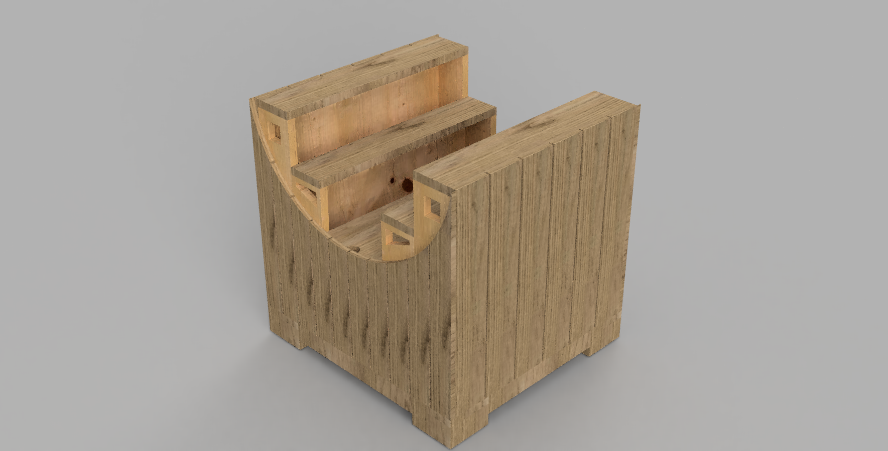
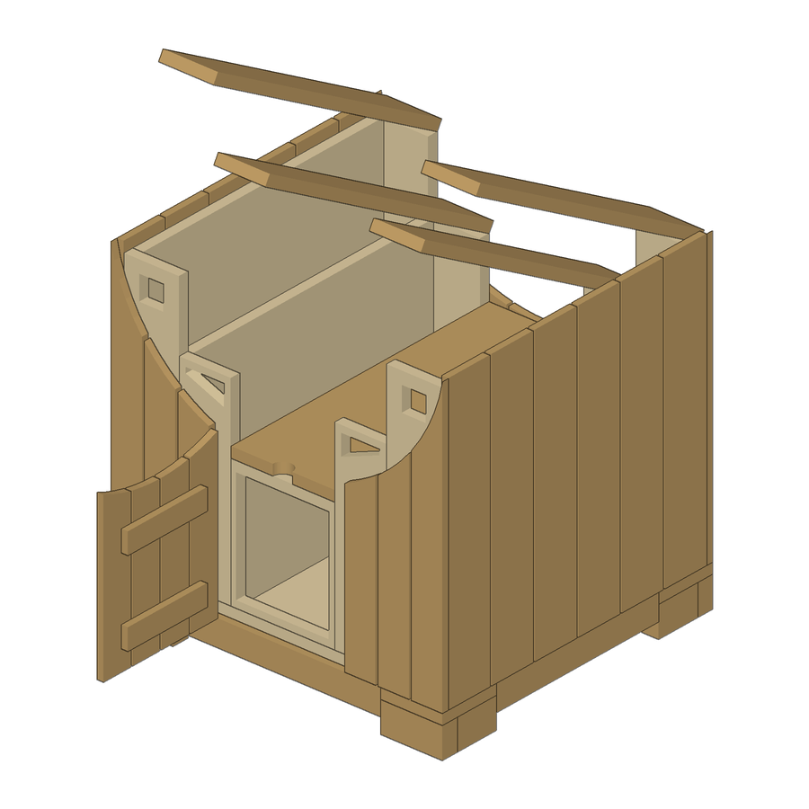

# fusionwright

**Describe a piece of furniture. Get a verified Fusion model, a cut list, a sheet-cutting plan and builder drawings.**

An open-source [MCP](https://modelcontextprotocol.io) server that lets an AI assistant (Claude, ChatGPT, Cursor, anything that speaks MCP) design and build real woodworking projects. It works in two layers:

| Layer | Needs | What you get |
|---|---|---|
| `wood_*` tools | **Nothing.** Pure Python, no CAD, no account | Parametric design, cut list (md/csv), board-foot estimate, plywood sheet nesting, lumber cutting plan, three-view dimensioned drawing (SVG), STL and OBJ |
| `cad_*` tools | `pip install "fusionwright[cad]"` ([CadQuery](https://github.com/CadQuery/cadquery) / OpenCascade, open source, **no Autodesk software, no membership**) | Run *any* CadQuery code for *any* object (brackets, enclosures, furniture), exact STEP + STL, volume/validity/interference checks, shaded previews. The wood designs also get exact STEP with names and colours |
| `fusion_*` tools | A licensed Autodesk Fusion (the free Personal-use tier works) | Build the design as named components in your live Fusion session, then *see* it, *verify* it with the kernel, render it, export it, or script anything else |



> Built, rendered and checked end to end through this server, from a hand sketch: 92 named parts (arc-cut slats, hinged lids, a hinged front door, finger openings, L-shaped feet hiding four casters), 24 x 22.5 x 24 in, zero interferences, one 4x8 plywood sheet, ~9.2 board feet of oak. The Fusion model and the open-source CadQuery model agree to the cubic inch (3454.89 in3). Details of how the sketch was read: [docs/SKETCH_SPEC.md](docs/SKETCH_SPEC.md).




## Why this exists

CAD is a skill barrier and, for most tools, a monthly bill. This project attacks the barrier: you say what you want, the server does the drafting, the arithmetic and the paperwork a builder needs. The `wood_*` layer needs no CAD at all, so a design, a shopping list and a set of drawings cost nothing. The `fusion_*` layer adds precise 3D modelling and photoreal renders if you already have Fusion.

It deliberately does **not** touch Fusion's licensing: it only uses Autodesk's documented public API, and needs a legitimately licensed Fusion to use the `fusion_*` tools.

## Quick start

1. **Install the add-in** (once): `./scripts/install_addin.sh`, then in Fusion press `Shift+S`, pick **FusionBridge**, click **Run** (tick *Run on Startup* to make it automatic).
2. **Register the server** with your client.

   Claude Desktop (`claude_desktop_config.json`):
   ```json
   { "mcpServers": { "fusionwright": {
       "command": "uvx",
       "args": ["--from", "git+https://github.com/Cocoloco20/fusionwright", "fusionwright"] } } }
   ```
   Claude Code: `claude mcp add fusionwright -- uvx --from git+https://github.com/Cocoloco20/fusionwright fusionwright`
3. **Ask.** *"Design a 24-inch rolling oak slat cabinet with three stepped lids, build it in Fusion, check it and show me."*

Only want the no-CAD tools? Skip step 1; `wood_design_cabinet` and `wood_report` work on their own. Outputs land in `~/fusionwright-projects/` (override with `FUSIONWRIGHT_HOME`).

## Tools (18)

A small surface on purpose: [fewer, higher-level tools beat dozens of thin wrappers](https://anthropic.com/engineering/writing-tools-for-agents).

| Tool | Purpose |
|---|---|
| `wood_design_cabinet` | Parametric slatted rolling cabinet (arc scoop, five hinged lids, a push-to-open front door onto the centre compartment, casters hidden in L-shaped feet; `open_deg` / `door_open_deg` pose the lids and door open); writes cut list, drawing, sheet layout, STL, OBJ, project.json, and with CadQuery an exact STEP + previews |
| `cad_run` | Run CadQuery code for any solid; returns STEP, STL, measurements and previews (open source, no Fusion) |
| `cad_preview` | Shaded previews of the last `cad_run` result or the current project (8 views), no CAD application needed |
| `cad_check` | Exact kernel check of the project: validity, boolean interference, expected size |
| `cad_export` | STEP (names + colours), STL or BREP with the open-source kernel |
| `cad_status` | Is the open-source backend installed? |
| `wood_report` | `cutlist`, `lumber` (1-D stock plan), `sheets` (plywood nesting), `drawing` |
| `wood_build_in_fusion` | Build the project in the open Fusion design, then verify it |
| `fusion_status` | Is Fusion reachable? Which document? |
| `fusion_api` | Look up the **real** Fusion API (class members with docs) before writing code |
| `fusion_run` | Run Python inside Fusion (helpers predefined); returns a rollback checkpoint |
| `fusion_rollback` | Undo everything after a checkpoint |
| `fusion_inspect` | Compact design state: sizes, volume, invalid bodies, timeline problems |
| `fusion_check` | Kernel validation: validity, timeline health, interference, expected size |
| `fusion_look` | Screenshots from iso/front/back/left/right/top/bottom |
| `fusion_render` | Photoreal render with Fusion's local renderer |
| `fusion_export` | STEP, STL, F3D, OBJ, 3MF, IGES, SAT (local files only) |
| `fusion_ui_command` | Run any of Fusion's ~3,000 UI commands by id |

Design choices informed by current research: results are concise and fixable (errors say how to repair the input); every build can be *verified* with kernel measurements and multi-angle images, because [executable CAD is often not correct CAD](https://arxiv.org/html/2608.09296v1) and [a validation loop sharply improves results](https://arxiv.org/html/2603.26512); `fusion_api` gives the model real documentation instead of guesses.

## How it compares

* **Autodesk's official Fusion MCP** (announced May 2026) is a thin scripting bridge: read/screenshot, run a script, undo/redo. It has no furniture knowledge, no cut lists, no drawings and no verification layer. fusionwright adds the domain layer.
* **Community Fusion MCPs** expose dozens of low-level CAD operations (the biggest lists 89 tools) and mostly stop there. fusionwright is deliberately small and domain-driven, runs its bridge on an authenticated loopback port, and gives you useful output without Fusion at all.

## Safety

See [SECURITY.md](SECURITY.md). In short: loopback only, bearer token (`~/.fusion-bridge-token`, mode 0600), Host-header guard, request-size cap; `fusion_run` blocks file deletion, network access and cloud saves by default and returns a rollback checkpoint. **It is a safety net, not a sandbox**: code you let an AI run inside Fusion is powerful. Save your work first.

## What's tested

* 22 unit tests: pure Python (including a signed-volume check that exported meshes are outward-facing, and a proof that no cabinet boards overlap), the add-in's HTTP layer with a stubbed Fusion, and a real stdio MCP round trip.
* 6 live tests against Fusion: build 76 boards and verify with the kernel, views that must differ from each other, 5 export formats, a real render, rollback, API lookup, and a full MCP client round trip that returns images.
* A 30-case capability suite (`tests/integration/capability_suite.py`) covering sketches, constraints, extrude/cut/revolve/sweep/loft, fillet/shell/chamfer/hole, patterns, booleans, components + joints, parameters, timeline edits, materials, measurement, 8 export formats, STEP re-import, CAM setup creation, configurations, rendering and more.

See [docs/COVERAGE.md](docs/COVERAGE.md) for what the Fusion API can and cannot do and [docs/GOTCHAS.md](docs/GOTCHAS.md) for API traps found along the way.

Tested on macOS with Fusion 2706.x. Windows is untested (the add-in is cross-platform in principle).

## Known limitations (honest list)

* Boards are **rectangular boxes**: no curves, joinery profiles or moulded parts yet.
* The cabinet reproduces a hand sketch. Two details were never confirmed and are **not modelled**: the dark wedges where the curve meets each tower, and the tilted blocks on the tower tops.
* Fusion-native *drawings* (`adsk.drawing`) can only be created from a design **saved to your Autodesk cloud**, so they are not automated here. The built-in SVG drawings need no cloud. Verify every dimension before cutting.
* The build is not driven by named Fusion parameters yet (boards are static features); change a dimension by re-running the generator.
* "Everything a human can do in Fusion" is not literally achievable through its API. `fusion_ui_command` and `fusion_run` cover a great deal, but some interactions (some drag gestures, cloud workflows) remain manual.

## Roadmap

Adapter for Autodesk's official Fusion MCP as an alternative backend · FreeCAD as a second open backend · more generators (bookcase, table, bench, shelf) and real joinery (dados, mortise-and-tenon, dovetails) · driving boards from Fusion user parameters · MCP Apps live 3D preview and cut-list viewer · MCP Tasks for long renders · a cross-model evaluation suite.

## Not affiliated

fusionwright is an independent project, not affiliated with or endorsed by Autodesk, Anthropic or OpenAI. "Autodesk" and "Fusion" are trademarks of Autodesk, Inc.

MIT licensed. Contributions welcome.
