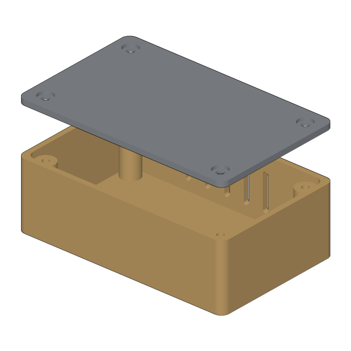
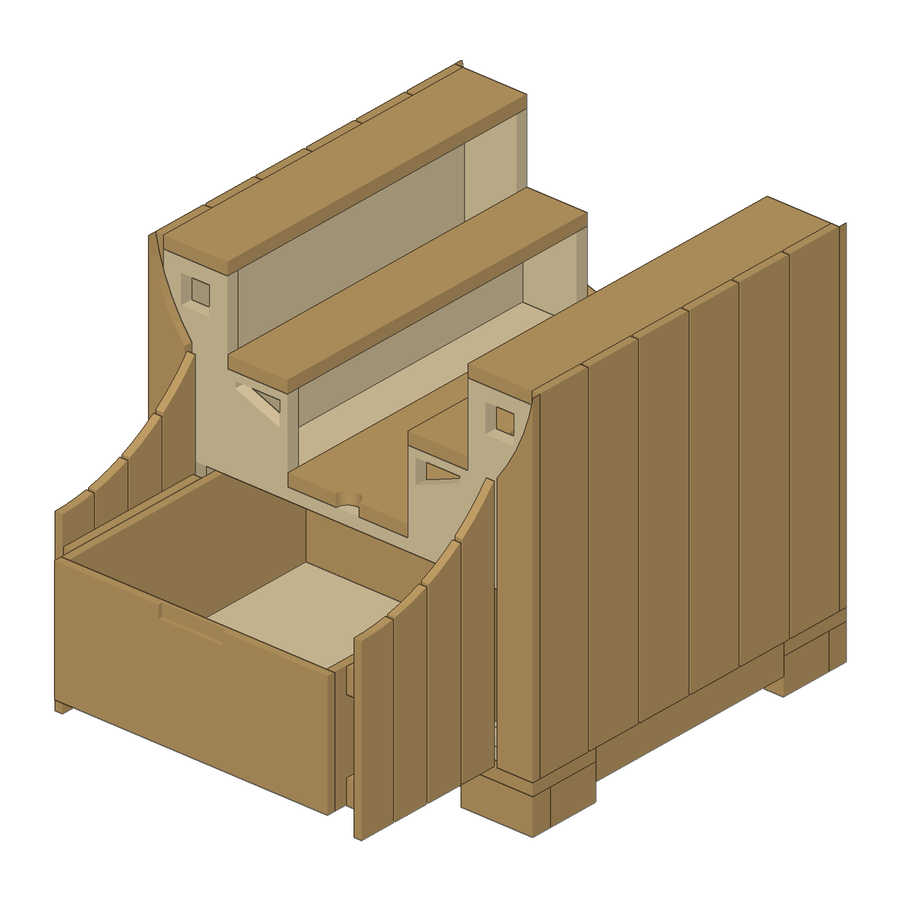
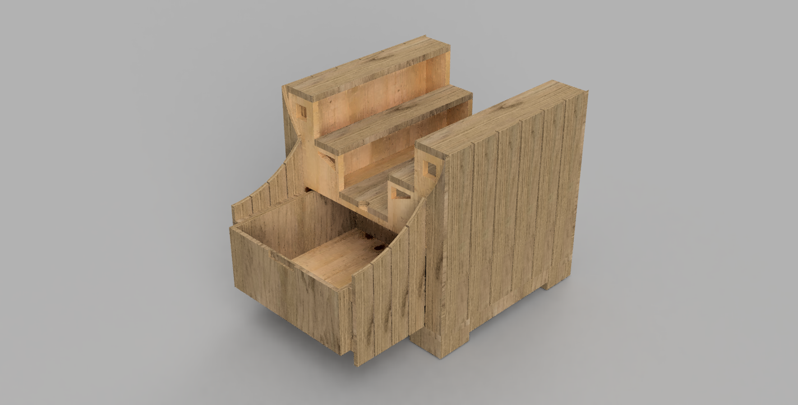
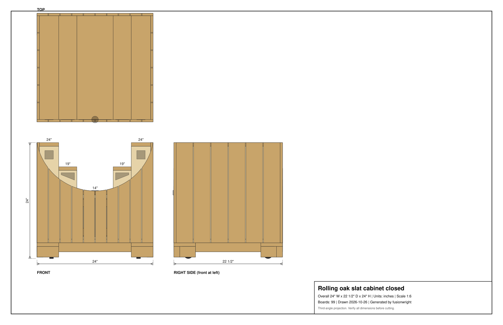

# fusionwright

**Let an AI build anything in Fusion, or with no CAD software at all.**

An open-source [MCP](https://modelcontextprotocol.io) server that gives an AI assistant (Claude, ChatGPT, Cursor, anything that speaks MCP) hands for real 3D modelling: it can write and run CAD code, *look* at the result, *measure and verify* it, and export files you can print, machine or hand to a builder. It is not tied to any one kind of object. Brackets, enclosures, gears, jigs, product mock-ups, furniture, anything solid.

| Layer | Needs | What you get |
|---|---|---|
| `cad_*` tools | `pip install "fusionwright[cad]"` ([CadQuery](https://github.com/CadQuery/cadquery) / OpenCascade, open source, **no Autodesk software, no membership**) | Run *any* CadQuery code for *any* object, exact STEP + STL, volume / validity / interference checks, shaded previews |
| `fusion_*` tools | A licensed Autodesk Fusion (the free Personal-use tier works) | Drive your live Fusion session: look up the **real** API, run Python, see the model from any side, verify it with Fusion's kernel, render it, export it, roll back mistakes, run any of Fusion's ~3,000 UI commands |
| Add-ons (optional) | Nothing | Domain generators that sit on top. Included: `wood_*`, a woodworking toolkit (cut lists, plywood sheet nesting, builder drawings). Add your own, see below |



*`examples/enclosure_cadquery.py`, run through `cad_run` with no Autodesk software: a filleted enclosure with screw posts, vent slots and a counter-bored lid. Exact STEP + STL come back with the volume and a validity check.*


*`examples/flange_fusion_run.py`, run through `fusion_run` in a live Fusion document: sketch, extrude, join, cut. The script checks Fusion's volume (37.542 cm3) against the hand-computed value (37.542 cm3), then `fusion_look` took this picture.*

## What it is for

Ask your AI for things like:

* *"Make a 80 x 50 x 25 mm enclosure for a PCB with four screw posts and vent slots, export a STEP and STL."*
* *"Model an M6 flange bracket with a 4-hole bolt circle in Fusion, then check it and show me from the front."*
* *"Take the part open in Fusion, find any invalid bodies or interferences and fix them."*
* *"Design a 24-inch rolling oak cabinet and give me the cut list."* (the woodworking add-on, below)

The loop that makes it dependable: **write code, look at it from several angles, measure it against the arithmetic, repair, repeat.** Executable CAD is often not correct CAD ([research](https://arxiv.org/html/2608.09296v1)), and [a validation loop sharply improves results](https://arxiv.org/html/2603.26512), so every layer has a way to check its own work.

## Why this exists

CAD is a skill barrier and, for most tools, a monthly bill. This project attacks the barrier: you say what you want, the server does the drafting and the arithmetic. The `cad_*` route costs nothing and needs no account. The `fusion_*` route adds Fusion's precise modelling, photoreal renders and file formats if you already have it.

It deliberately does **not** touch Fusion's licensing: it only uses Autodesk's documented public API, and needs a legitimately licensed Fusion for the `fusion_*` tools.

## Quick start

1. **Free route:** `pip install "fusionwright[cad]"`, register the server (step 3), ask for a part. No Fusion needed.
2. **Fusion route (once):** `./scripts/install_addin.sh`, then in Fusion press `Shift+S`, pick **FusionBridge**, click **Run** (tick *Run on Startup* to make it automatic).
3. **Register the server** with your client.

   Claude Desktop (`claude_desktop_config.json`):
   ```json
   { "mcpServers": { "fusionwright": {
       "command": "uvx",
       "args": ["--from", "git+https://github.com/Cocoloco20/fusionwright", "fusionwright"] } } }
   ```
   Claude Code: `claude mcp add fusionwright -- uvx --from git+https://github.com/Cocoloco20/fusionwright fusionwright`
4. **Ask.** Outputs land in `~/fusionwright-projects/` (override with `FUSIONWRIGHT_HOME`).

## Tools (18)

A small surface on purpose: [fewer, higher-level tools beat dozens of thin wrappers](https://anthropic.com/engineering/writing-tools-for-agents).

**General (any object)**

| Tool | Purpose |
|---|---|
| `cad_run` | Run CadQuery code for any solid; returns STEP, STL, measurements and previews (open source, no Fusion) |
| `cad_preview` | Shaded previews of the last `cad_run` result or the current project (8 views), no CAD application needed |
| `cad_check` | Exact kernel check: validity, boolean interference, expected size |
| `cad_export` | STEP (names + colours), STL or BREP with the open-source kernel |
| `cad_status` | Is the open-source backend installed? |
| `fusion_status` | Is Fusion reachable? Which document? |
| `fusion_api` | Look up the **real** Fusion API (class members with docs) before writing code |
| `fusion_run` | Run Python inside Fusion (helpers predefined); returns a rollback checkpoint |
| `fusion_rollback` | Undo everything after a checkpoint |
| `fusion_inspect` | Compact design state: sizes, volume, invalid bodies, timeline problems |
| `fusion_check` | Kernel validation: validity, timeline health, interference, expected size |
| `fusion_look` | Screenshots from iso/front/back/left/right/top/bottom |
| `fusion_render` | Photoreal render with Fusion's local renderer |
| `fusion_export` | STEP, STL, F3D, OBJ, 3MF, IGES, SAT (local files only) |
| `fusion_ui_command` | Run any of Fusion's ~3,000 UI commands by id |

**Woodworking add-on (optional)**

| Tool | Purpose |
|---|---|
| `wood_design_cabinet` | Parametric slatted rolling cabinet; writes cut list, drawing, sheet layout, STL, OBJ, project.json, and with CadQuery an exact STEP + previews |
| `wood_report` | `cutlist`, `lumber` (1-D stock plan), `sheets` (plywood nesting), `drawing` |
| `wood_build_in_fusion` | Build the current project in the open Fusion design (named components, arcs, cuts, hinge poses), then verify it |

The core tools know nothing about furniture. Each `fusion_*` / `cad_*` call stands alone.

## Examples

| File | Route | What it shows |
|---|---|---|
| [`examples/enclosure_cadquery.py`](examples/enclosure_cadquery.py) | open source (`cad_run`) | shell, fillets, hole patterns, slots, multi-part colours |
| [`examples/flange_fusion_run.py`](examples/flange_fusion_run.py) | Fusion (`fusion_run`) | sketches, extrude/join/cut, picking profiles by area, checking against hand arithmetic |
| [Woodworking add-on](#woodworking-add-on-an-end-to-end-example) | both | a 95-part design, cut list, drawings, hinged parts, built in Fusion |

## Make your own add-on

An add-on is a plain Python generator that returns a `Project` (a list of parts, each a box, extruded profile with arcs, or cylinder, with cuts, materials and an optional hinge rotation; see [`shapes.py`](src/fusionwright/shapes.py) and [`model.py`](src/fusionwright/model.py)). The same description is meshed to STL with no CAD, built exactly with CadQuery, and built in Fusion, so one generator feeds every route. The cabinet in [`cabinet.py`](src/fusionwright/cabinet.py) is the reference. Contributions for other domains (enclosures, shelving, brackets, signage...) are welcome.

## Woodworking add-on: an end-to-end example

Describe a piece of furniture; get a verified Fusion model, a cut list, a sheet-cutting plan and builder drawings. The `wood_*` layer needs no CAD at all.


> Built, rendered and checked end to end through this server, from a hand sketch: 95 named parts (arc-cut slats, hinged lids, a pair of push-to-open front doors with two hinges each spanning the whole front between the corner slats, one wide pull-out drawer behind them, finger openings, L-shaped feet hiding four casters), 24 x 22.5 x 24 in, zero interferences, one 4x8 plywood sheet, ~11.2 board feet of oak. The Fusion model and the open-source CadQuery model agree to the cubic inch. How the sketch was read: [SKETCH_SPEC.md](docs/examples/woodworking/SKETCH_SPEC.md); the generated [cut list](docs/examples/woodworking/example_cutlist.md).







Try: *"Design a 24-inch rolling oak slat cabinet with three stepped lids, double push-to-open front doors and a pull-out drawer, build it in Fusion, check it and show me."* Details: `door_open_deg` and `drawer_out` pose the doors and drawer open (`open_deg` also lifts the lids, off by default); `door_pull="bar"` swaps the hidden push latches for slim vertical pulls; `door_span` is `"full"` (default, the whole front), `"wide"` (middle three sections) or `"centre"`; `door_leaves=1` gives a single door; `door=False` / `drawer=False` remove them.

## How it compares

* **Autodesk's official Fusion MCP** (announced May 2026) is a thin scripting bridge: read/screenshot, run a script, undo/redo. fusionwright adds a verification layer (kernel checks, multi-angle images, rollback checkpoints), a no-Fusion route, and optional domain add-ons.
* **Community Fusion MCPs** expose dozens of low-level CAD operations (the biggest lists 89 tools) and mostly stop there. fusionwright is deliberately small, runs its bridge on an authenticated loopback port, and gives you useful output without Fusion at all.

## Safety

See [SECURITY.md](SECURITY.md). In short: loopback only, bearer token (`~/.fusion-bridge-token`, mode 0600), Host-header guard, request-size cap; `fusion_run` blocks file deletion, network access and cloud saves by default and returns a rollback checkpoint. **It is a safety net, not a sandbox**: code you let an AI run inside Fusion is powerful. Save your work first.

## What's tested

* 30 unit tests: pure Python (including a signed-volume check that exported meshes are outward-facing and a proof that no cabinet boards overlap), the add-in's HTTP layer with a stubbed Fusion, a real stdio MCP round trip, and the open-source CAD backend (skipped when CadQuery is not installed).
* Live tests against a real Fusion: build and kernel-verify the 95-part cabinet, views that must differ from each other, 5 export formats, a real render, rollback, API lookup, and a full MCP client round trip that returns images.
* A 30-case capability suite (`tests/integration/capability_suite.py`) covering sketches, constraints, extrude/cut/revolve/sweep/loft, fillet/shell/chamfer/hole, patterns, booleans, components + joints, parameters, timeline edits, materials, measurement, 8 export formats, STEP re-import, CAM setup creation, configurations, rendering and more.

See [docs/COVERAGE.md](docs/COVERAGE.md) for what the Fusion API can and cannot do and [docs/GOTCHAS.md](docs/GOTCHAS.md) for API traps found along the way.

Tested on macOS with Fusion 2706.x. Windows is untested (the add-in is cross-platform in principle).

## Known limitations (honest list)

* Fusion-native *drawings* (`adsk.drawing`) can only be created from a design **saved to your Autodesk cloud**, so they are not automated here. Verify every dimension before cutting, printing or machining.
* "Everything a human can do in Fusion" is not literally achievable through its API. `fusion_ui_command` and `fusion_run` cover a great deal, but some interactions (some drag gestures, cloud workflows) remain manual.
* `cad_run` is a safety net, not a sandbox: it runs in a separate process with a time limit and blocks obviously dangerous calls.
* The woodworking cabinet reproduces one hand sketch. Two details were never confirmed and are **not modelled**: the dark wedges where the curve meets each tower, and the tilted blocks on the tower tops. Its builds are static features, not driven by named Fusion parameters.

## Roadmap

Adapter for Autodesk's official Fusion MCP as an alternative backend · FreeCAD as a second open backend · more add-ons (enclosures, shelving, brackets, bookcase/table/bench) and real joinery · driving models from Fusion user parameters · MCP Apps live 3D preview · MCP Tasks for long renders · a cross-model evaluation suite.

## Not affiliated

fusionwright is an independent project, not affiliated with or endorsed by Autodesk, Anthropic or OpenAI. "Autodesk" and "Fusion" are trademarks of Autodesk, Inc.

MIT licensed. Contributions welcome.
