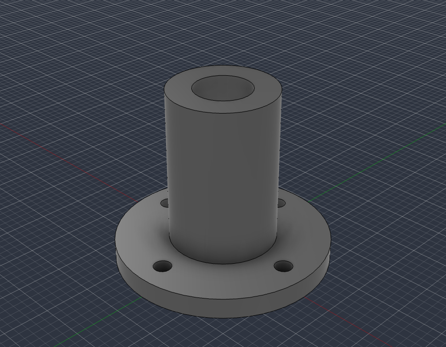

# fusionwright

**Let an AI build in Autodesk Fusion for you.**

An open-source [MCP](https://modelcontextprotocol.io) server that connects an AI assistant (Claude, ChatGPT, Cursor, anything that speaks MCP) to your live Fusion session. You describe what you want; the AI writes the Fusion code, **looks** at the result from several angles, **measures and verifies** it with Fusion's own kernel, fixes its mistakes, then renders it and exports files you can print, machine or send on. It is not tied to any kind of object: brackets, enclosures, gears, jigs, furniture, product mock-ups, anything solid.



*`examples/flange_fusion_run.py`, run through `fusion_run` in a live Fusion document: sketch, extrude, join, cut. The script checks Fusion's volume (37.542 cm3) against the hand-computed value (37.542 cm3), then `fusion_look` took this picture.*

## What you can ask for

* *"Make an 80 x 50 x 25 mm enclosure for a PCB with four screw posts and vent slots, then export a STEP and an STL."*
* *"Model an M6 flange bracket with a 4-hole bolt circle, check it, and show me from the front."*
* *"Take the part open in Fusion, find any invalid bodies or interferences and fix them."*
* *"Add a 2 mm fillet to every outside edge and render it in brushed aluminium."*
* *"Build a 24-inch bookcase from 3/4 inch plywood and give me every part as its own component."*

The loop that makes it dependable: **write code, look at it, measure it against the arithmetic, repair, repeat.** Executable CAD is often not correct CAD ([research](https://arxiv.org/html/2608.09296v1)), and [a validation loop sharply improves results](https://arxiv.org/html/2603.26512), so the tools are built around checking the work.

## Requirements

* Autodesk Fusion on macOS (tested) or Windows (untested). The free Personal-use tier works.
* Python 3.10+ and an MCP client.

It only uses Autodesk's documented public API and a legitimately licensed Fusion; it does not touch licensing.

## Quick start

1. **Install the bridge add-in (once):** run `./scripts/install_addin.sh`, then in Fusion press `Shift+S`, pick **FusionBridge**, click **Run** (tick *Run on Startup* to make it automatic).
2. **Register the server** with your client.

   Claude Desktop (`claude_desktop_config.json`):
   ```json
   { "mcpServers": { "fusionwright": {
       "command": "uvx",
       "args": ["--from", "git+https://github.com/Cocoloco20/fusionwright", "fusionwright"] } } }
   ```
   Claude Code: `claude mcp add fusionwright -- uvx --from git+https://github.com/Cocoloco20/fusionwright fusionwright`
3. **Ask.** Exports land in `~/fusionwright-projects/` (override with `FUSIONWRIGHT_HOME`).

## Tools (10)

A small surface on purpose: [fewer, higher-level tools beat dozens of thin wrappers](https://anthropic.com/engineering/writing-tools-for-agents).

| Tool | Purpose |
|---|---|
| `fusion_status` | Is Fusion reachable? Which document is open? |
| `fusion_api` | Look up the **real** Fusion API (class members with docs) before writing code |
| `fusion_run` | Run Python inside Fusion (helpers predefined); returns a rollback checkpoint |
| `fusion_rollback` | Undo everything after a checkpoint |
| `fusion_inspect` | Compact design state: sizes, volume, invalid bodies, timeline problems |
| `fusion_check` | Kernel validation: body validity, timeline health, interference, expected size |
| `fusion_look` | Screenshots from iso / front / back / left / right / top / bottom |
| `fusion_render` | Photoreal render with Fusion's local renderer |
| `fusion_export` | STEP, STL, F3D, OBJ, 3MF, IGES, SAT (local files only) |
| `fusion_ui_command` | Run any of Fusion's ~3,000 UI commands by id, or search them |

Inside `fusion_run` the names `app`, `ui`, `design`, `root`, `adsk`, `P3`, `VI`, `FO`, `IN`, `coll()` and `board()` are predefined; assign your answer to `result`. Fusion works in centimetres internally.

## Examples

| File | What it shows |
|---|---|
| [`examples/flange_fusion_run.py`](examples/flange_fusion_run.py) | sketches, extrude / join / cut, picking profiles by area, checking against hand arithmetic |

Contributions of more examples (enclosures, gears, sheet metal, assemblies, anything) are welcome.

## How it compares

* **Autodesk's official Fusion MCP** (announced May 2026) is a thin scripting bridge: read / screenshot, run a script, undo / redo. fusionwright adds a verification layer (kernel checks, multi-angle images, rollback checkpoints, an API lookup, UI-command access).
* **Community Fusion MCPs** expose dozens of low-level CAD operations (the biggest lists 89 tools) and mostly stop there. fusionwright is deliberately small and runs its bridge on an authenticated loopback port.

## Safety

See [SECURITY.md](SECURITY.md). In short: loopback only, bearer token (`~/.fusion-bridge-token`, mode 0600), Host-header guard, request-size cap; `fusion_run` blocks file deletion, network access and cloud saves by default and returns a rollback checkpoint. **It is a safety net, not a sandbox**: code you let an AI run inside Fusion is powerful. Save your work first.

## What's tested

* 9 unit tests: the add-in's HTTP layer with a stubbed Fusion (token, host guard, size cap, error tracebacks) and a real stdio MCP round trip (tool list, safety guard, error messages).
* Live tests against a real Fusion (`pytest tests/integration`): build a part and verify sizes, volume and interference with the kernel, views that must differ from each other, 5 export formats, a real render, rollback, API lookup, UI-command search, and a full MCP client round trip that returns images.
* A 30-case capability suite (`tests/integration/capability_suite.py`) covering sketches, constraints, extrude / cut / revolve / sweep / loft, fillet / shell / chamfer / hole, patterns, booleans, components and joints, parameters, timeline edits, materials, measurement, 8 export formats, STEP re-import, CAM setup creation, configurations, rendering and more.

See [docs/COVERAGE.md](docs/COVERAGE.md) for what the Fusion API can and cannot do and [docs/GOTCHAS.md](docs/GOTCHAS.md) for API traps found along the way.

## Known limitations

* Fusion-native *drawings* (`adsk.drawing`) can only be created from a design **saved to your Autodesk cloud**, so they are not automated here. Verify every dimension before cutting, printing or machining.
* "Everything a human can do in Fusion" is not literally achievable through its API. `fusion_ui_command` and `fusion_run` cover a great deal, but some interactions (some drag gestures, cloud workflows) remain manual.

## Roadmap

Adapter for Autodesk's official Fusion MCP as an alternative transport · more verified examples · driving models from Fusion user parameters · MCP Apps live 3D preview · MCP Tasks for long renders · a cross-model evaluation suite.

## Not affiliated

fusionwright is an independent project, not affiliated with or endorsed by Autodesk, Anthropic or OpenAI. "Autodesk" and "Fusion" are trademarks of Autodesk, Inc.

MIT licensed. Contributions welcome.
